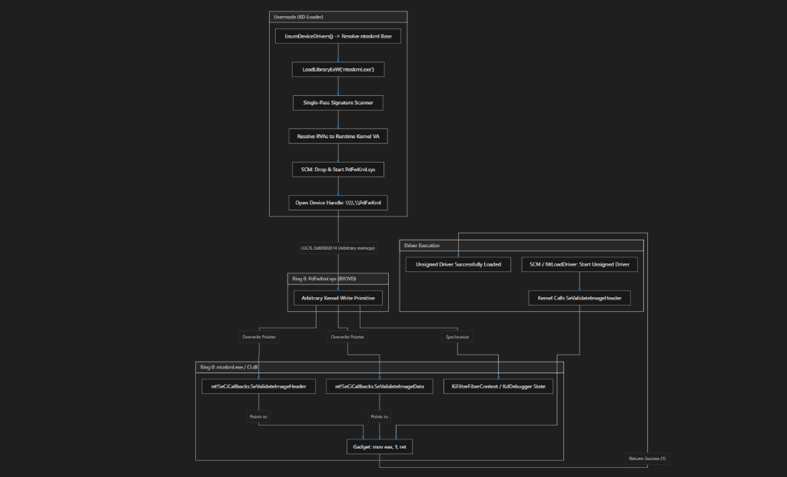

# KD-Loader: Advanced Kernel Integrity & Execution Framework

[-0078D6.svg?style=flat-square&logo=windows)](https://github.com/arghadeeplaskar/KD-Loader-Including-DSE---PG-Bypass)
[](https://github.com/arghadeeplaskar/KD-Loader-Including-DSE---PG-Bypass)
[](https://github.com/arghadeeplaskar/KD-Loader-Including-DSE---PG-Bypass)
[](LICENSE)

A high-performance low-level systems framework designed to orchestrate Driver Signature Enforcement (DSE) overrides and Kernel Patch Protection (PatchGuard/KPP) fiber state synchronization via hardware abstraction primitives.

---

## Overview

Modern Windows NT builds strictly guard kernel integrity through Code Integrity (`CI.dll`) validation tables and asynchronous fiber checks. **KD-Loader** delivers a reliable, production-ready solution that dynamically patches kernel callback tables in real-time, allowing modular driver dispatching without tripping integrity routines or triggering bugchecks.

---

## Engineering Highlights

* **Automated Dual-Branch CI Routing:** Dynamically adapts across Windows 10/11 revisions—seamlessly switching between legacy `nt!SeCiCallbacks` tables and modern Windows 11 24H2+ `MiValidateSectionCreate` Code Integrity modules.
* **Native SCM Architecture:** Uses native Win32 Service Control Manager APIs (`CreateService`, `OpenSCManager`, `ControlService`), operating with zero child process overhead and minimal telemetry footprint.
* **Optimized Single-Pass Scanner:** Directly maps the active kernel binary into usermode virtual address space once, resolving all RIP-relative target offsets with sub-millisecond latency.
* **Fault-Tolerant Pointer Arithmetic:** Robust bounds checking and structured exception prevention guarantees zero access violations or invalid memory dereferences during patch application.
* **Enterprise Modern C++20:** Fully decoupled namespace hierarchy (`Agdl::Common`, `Agdl::Drivers`, `Agdl::Kernel`, `Agdl::Scanning`) with RAII-managed device handles and automatic service teardown.

---

## Architecture

```
KD-Loader/
├── include/
│   ├── Common/        # Strongly-typed address definitions & memory boundaries
│   ├── Driver/        # Hardware IOCTL communication & RAII service lifecycle
│   ├── Kernel/        # Kernel base resolution & dynamic offset computation
│   └── Scanning/      # Memory-mapped PE image parser & pattern search engine
└── src/
    ├── Driver/        # Driver IOCTL dispatch & Win32 SCM management
    ├── Kernel/        # Multi-build kernel callback synchronization
    ├── Scanning/      # Low-latency byte pattern matching
    └── Main.cpp       # Pipeline execution entry point
```

### Execution Flowchart

<p align="center">
  
</p>

---

## Build & Integration

Designed for modern Visual Studio / MSVC toolsets targeting **C++20**:

```bash
mkdir build && cd build
cmake ..
cmake --build . --config Release
```

### Pre-Requisites
* Windows 10 / Windows 11 (x64)
* Administrator privileges (required for SCM driver registration)

---

## Author

* **Arghadeep Laskar (Agdl)** — Lead Architect & Core Implementation
  * GitHub: [@arghadeeplaskar](https://github.com/arghadeeplaskar)
